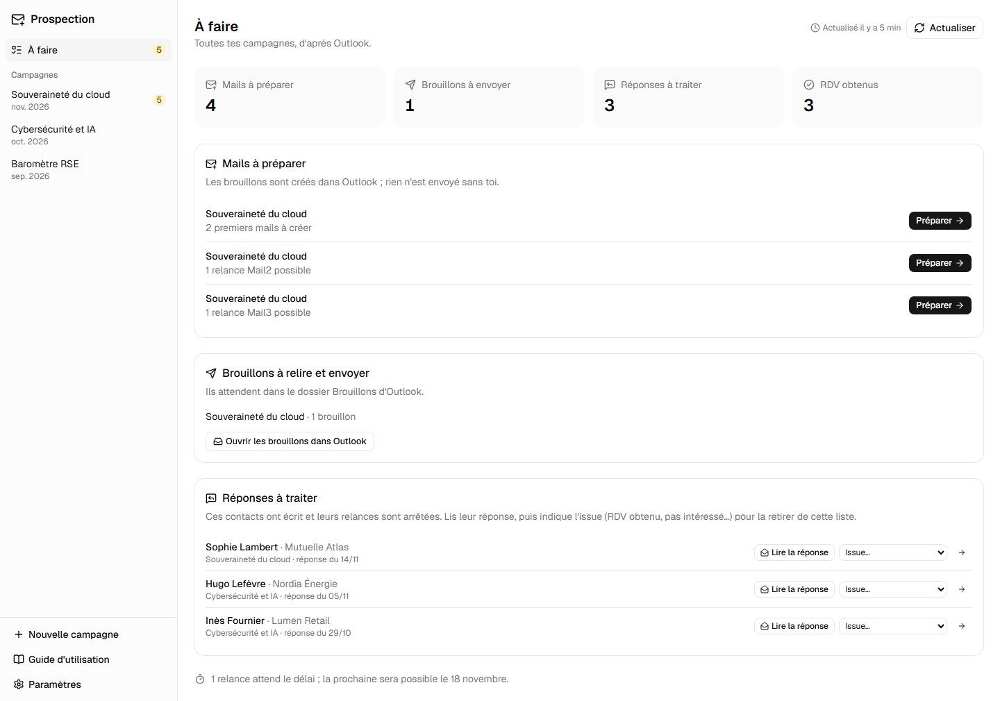
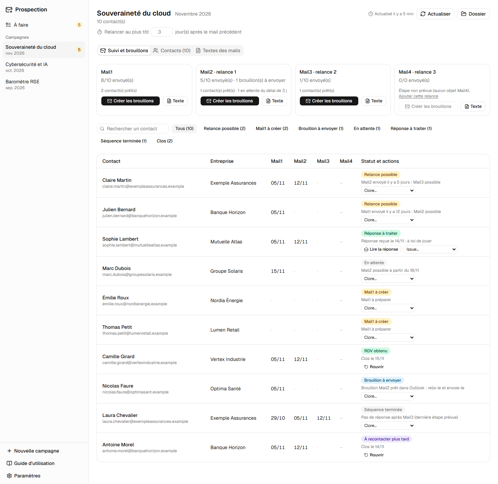
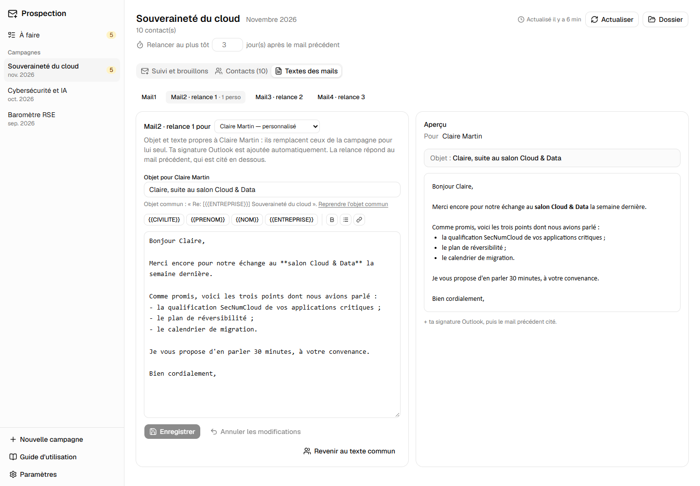

# Prospection Outlook

Outil de campagnes de prospection par e-mail pour **Outlook classique (Windows)** : un premier mail puis jusqu'à 3 relances, chaque relance répondant au mail précédent dans le même fil de discussion.

L'outil prépare des **brouillons** dans Outlook, avec ta signature. **Rien n'est jamais envoyé automatiquement** : tu relis et tu envoies toi-même depuis Outlook.

Tout se fait depuis une interface web locale :

- création des campagnes ;
- saisie des contacts (ou collage depuis Excel ou Outlook) ;
- rédaction des 4 mails, objet et texte, avec aperçu ;
- **objet et texte personnalisés** pour un contact précis, à n'importe quelle étape ;
- suivi contact par contact : mails envoyés, réponses, relance possible ;
- création des brouillons en un clic ;
- mise à jour de l'outil en un clic (page Paramètres) ;
- guide d'utilisation intégré.

Les relances s'arrêtent d'elles-mêmes pour un contact qui a répondu. Les réponses sont cherchées dans la Boîte de réception et ses sous-dossiers, et les réponses automatiques (absence du bureau…) sont ignorées.

## Aperçu

**La page « À faire »** résume toutes les campagnes : mails à préparer, brouillons à envoyer, réponses à traiter.



**Le suivi d'une campagne** montre, contact par contact, les mails envoyés, les réponses et la prochaine action, avec la création des brouillons étape par étape.



**Les textes des mails** se rédigent avec un aperçu. Un contact peut recevoir un objet et un texte qui lui sont propres, à n'importe quelle étape.



*Captures réalisées avec des données fictives.*

## Installation (utilisateurs)

Prérequis : Windows et **Outlook classique** (pas le « nouvel Outlook »), avec une signature par défaut. Rien d'autre : l'outil est **portable**. Il ne demande ni droits administrateur ni installation dans Windows, et n'a pas besoin de Node.js pour fonctionner.

1. Télécharge **[Installer.bat](https://github.com/raphaeldeux/prospection-outlook/releases/latest/download/Installer.bat)**.
2. Double-clique dessus. Si Windows affiche « Windows a protégé votre ordinateur », clique sur *Informations complémentaires* puis *Exécuter quand même*.
3. Accepte le dossier proposé (`Documents\Prospection`) ou indiques-en un autre. Réponds **N** à la question sur les outils de développement.
4. Ouvre Outlook, puis double-clique **Prospection Outlook** (l'icône enveloppe, sur le Bureau ou dans ton dossier Prospection). L'outil s'ouvre dans **sa propre fenêtre**, sans fenêtre noire. Une **icône près de l'horloge** permet de le rouvrir ou de le quitter. Fermer la fenêtre suffit : l'outil s'arrête seul quelques minutes plus tard.
5. Clique sur **Guide d'utilisation**, en bas à gauche de l'interface.

L'installeur :

- vérifie les prérequis : Outlook classique et signature ;
- télécharge la **dernière version publiée** (la dernière [Release](https://github.com/raphaeldeux/prospection-outlook/releases)), jamais un travail en cours ;
- la copie dans ton dossier ;
- crée le raccourci **Prospection Outlook** dans le dossier, sur le Bureau et dans le menu Démarrer.

Le dossier installé est volontairement simple :

```
Prospection Outlook   le raccourci à double-cliquer
Campagnes\            tes campagnes (une campagne = un dossier)
LisezMoi.txt
Programme\            l'outil lui-même : rien à ouvrir ni à modifier
```

**Mettre à jour** : dans l'interface, **Paramètres → Mettre à jour**. La page se recharge toute seule sur la nouvelle version. Tu peux aussi relancer un `Installer.bat` fraîchement téléchargé (ou `Programme\Installer ou mettre a jour.bat`) : il retrouve tout seul ton dossier d'installation, même s'il ne s'agit pas du dossier par défaut. Tes campagnes, dans `Campagnes\`, ne sont jamais modifiées : seul le dossier `Programme\` est remplacé. Un dossier installé avec la version 1.11 ou une version antérieure est rangé automatiquement à la mise à jour.

**Sans l'installeur** : clique sur *Code > Download ZIP*, copie le contenu du dossier `outil` où tu veux, puis lance une fois `Programme\Interface.bat` : il crée le raccourci **Prospection Outlook**.

## Confidentialité

Tes campagnes (contacts, textes) restent sur ton poste, dans `Campagnes\`. L'interface ne fonctionne qu'en local (`http://localhost:8765`), et aucune donnée n'est envoyée ailleurs. La seule connexion sortante consulte GitHub pour connaître la dernière version publiée. Ne publie jamais ton dossier `Campagnes\` : le `.gitignore` du dépôt l'exclut.

Chaque campagne est un dossier de `Campagnes\` :

```
contacts.csv              contacts et objets des 4 mails (colonnes Sujet1 à Sujet4)
Textes\Mail1.txt … Mail4.txt   textes communs
Textes\personnalises.json      textes propres à certains contacts (par adresse e-mail)
issues.json               issue de chaque contact clos (RDV obtenu, pas intéressé…)
parametres.json           délai avant relance et objets communs des 4 mails
```

## Organisation du dépôt

```
Installer.bat           installeur / mise à jour portable (fichier autonome, publié dans les Releases)
outil/                  ce que les utilisateurs copient (prêt à l'emploi)
  LisezMoi.txt
  Programme/            l'outil (le raccourci « Prospection Outlook » est créé à côté à l'installation)
    Interface.bat       lance l'application (Interface.bat /console : avec le journal en direct, pour le dépannage)
    Scripts/            moteur PowerShell (pilote Outlook en COM)
      Application.ps1     lanceur sans console : serveur en arrière-plan, icône près de l'horloge, fenêtre Edge
      Serveur-Interface.ps1  serveur local de l'interface (localhost:8765)
      Raccourci.ps1       crée le raccourci « Prospection Outlook » (icône de l'outil)
      Migrer-Dossier.ps1  range un dossier installé avec l'ancienne organisation
    Interface/app/      interface compilée (versionnée : pas besoin de Node pour l'utiliser)
    Modele campagne/    copié pour chaque nouvelle campagne
interface/              code source de l'interface (React + Vite + shadcn/ui)
Deployer.ps1            copie outil/ vers un dossier de travail sans toucher aux campagnes
```

## Développement

Lance `Installer.bat` et réponds **O** à la question sur les outils de développement. L'installeur :

- télécharge **Node.js portable**, la dernière LTS, dans `%LOCALAPPDATA%\Programs`, et vérifie son empreinte SHA-256 ;
- clone ce dépôt dans `%LOCALAPPDATA%\prospection-outlook` (ou le copie si git est absent) ;
- installe les dépendances ;
- crée `Developpement.cmd`, qui ouvre une console avec Node dans le PATH.

Dans cette console, qui s'ouvre directement dans `interface\` :

```bat
npm run dev       & rem interface en mode developpement (http://localhost:5173), avec le serveur lance a cote :
                  & rem powershell -File ..\outil\Scripts\Serveur-Interface.ps1 -SansNavigateur
npm run build     & rem compile dans outil\Interface\app
cd ..
powershell -File Deployer.ps1 -Cible "C:\chemin\vers\ton\dossier\Prospection"
```

`Deployer.ps1` écrit dans `Programme\version.txt` le dernier tag de release, suivi de `+local` si `outil/` a changé depuis.

### Publier une version

Les utilisateurs n'installent que les **Releases** : un commit sur `main` ne leur parvient qu'à la publication de la release suivante.

1. Compile l'interface (`npm run build`), commite et pousse sur `main`.
2. Crée la release avec un tag `vX.Y.Z` et des notes de version lisibles par les utilisateurs : elles s'affichent dans la page Paramètres de l'interface.
3. **Joins `Installer.bat` à la release** : le lien de téléchargement de ce README (`releases/latest/download/Installer.bat`) pointe sur le fichier joint de la dernière release.

```bat
gh release create vX.Y.Z Installer.bat --target main --title "Prospection Outlook X.Y.Z" --notes-file notes.md
```

Pense à mettre à jour le guide intégré (`interface/src/Guide.tsx`) quand un comportement change.
